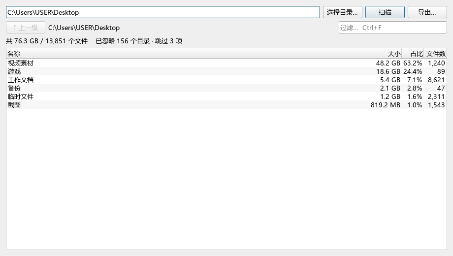

# filetidy

很多电脑小白们常常会面临 C 盘/系统盘 用着用着就爆红存满的问题，而市面上大多数的杀毒软件或者自带的一些管家类软件在对 C 盘/系统盘 进行清理的时候通常会直接一刀切。这会导致一些人存在 C 盘/系统盘里的重要资料被清理。
所以做这个程序的原因，就是知道盘内到底**有什么东西占用了大多数的容量**。

filetidy 主要包含了以下功能

- 搜寻文件夹中的文件**占用**空间
- 寻找可以被搜寻到的**文件夹**所在的目录
- 以及有没有**重复文件**在偷偷占两份空间

且我保证**程序为只读程序，不删任何东西。** 
所以它不提供任何删除功能，如果您在使用完成后需要删什么文件或内容，请自行判断。
**作者不对你的数据负责。**

## 怎么用

去 [Releases](https://github.com/nmkllp/filetidy/releases) 下载 `filetidy-win64.zip`。

**解压到一个文件夹里**，双击里面的 `filetidy.exe`。

> 整个文件夹一起留着。exe 旁边那些 dll 是它的必要运行环境，只把 exe 单独拖出来会跑不起来，如果觉得膈应建议创建快捷方式在桌面上。

然后：

1. 选一个文件夹或者整个可识别磁盘
2. 点「扫描」
3. 等进度条走完

扫完你会看到一张表：每个子文件夹占多大、占多少比例。**双击任意一行进入下一层**，`↑ 上一级` 回去。

几个常用的操作：

- 顶部输入框可以过滤，`Ctrl+F` 直接跳进去
- 可以在扫描过程中随时终止扫描工作
- 「查重复」会列出重复文件
- 右键可以「在资源管理器中打开」或者「复制路径」
- 「导出…」可以把当前这一层存成 CSV 表格，用 Excel 打开不会乱码
- 下次打开会自动回到上次扫描的目录
- `F5` 重新扫描，`Backspace` 回上一级

在扫描 C 盘这类目录会慢一些，也许会持续几分钟甚至十几分钟，不过是正常的。之后在子文件夹之间来回切换是瞬时的，不会重新扫描。

## 它不会做的事

- 目前不可以操作任何文件夹，也不会修改任何系统设置
- 认不出没在注册表里登记的软件

## 许可

[MIT](LICENSE)。作者不对你的数据承担责任。如若误删、错删，后果需要你自己承担。

感谢使用喵~
