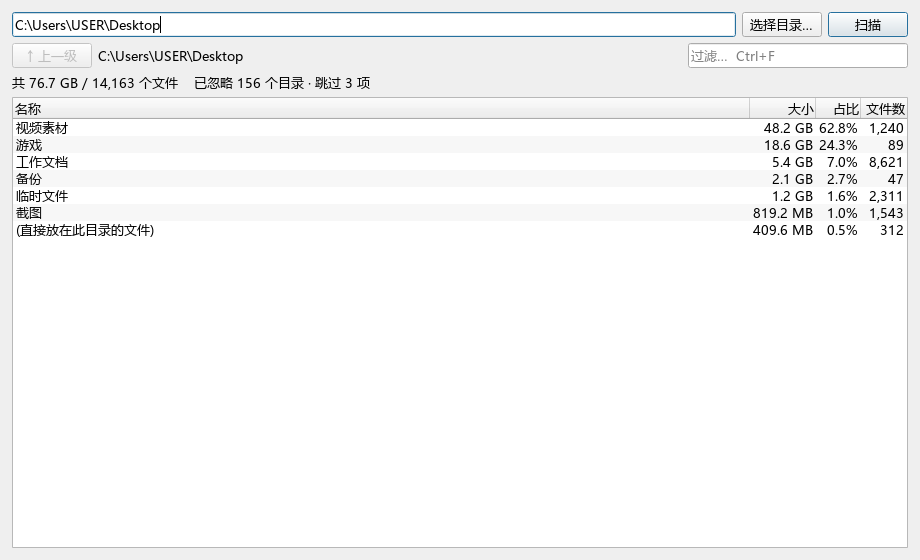

# filetidy

对于电脑用户来说有时候磁盘满了，Windows系统只给你的磁盘频频报红，却不告诉你**到底是什么在侵蚀你的磁盘容量**。

所以我写了一个程序 filetidy，它把同一个文件夹从三个角度拆开看：

- 有什么**东西**在占地方
- 在哪个**文件夹**里
- 有没有**重复文件**在偷偷占两份空间

扫完之后你也许就会发现：有多少文件夹占用了多少空间。

**它只读，不删任何东西。** 目前它还没法可靠区分「系统自带的文件」和「你自己产生的缓存」，所以它不提供任何删除功能——要删什么，请你亲自判断。作者不对你的数据负责。

## 怎么用

去 [Releases](https://github.com/nmkllp/filetidy/releases) 下载 `filetidy-win64.zip`。

**解压到一个文件夹里**，双击里面的 `filetidy.exe`。

> 整个文件夹一起留着。exe 旁边那些 dll 是它的零件，只把 exe 单独拖出来会跑不起来。

然后：

1. 选一个文件夹
2. 点「扫描」
3. 等进度条走完

扫完你会看到一张表：每个子文件夹占多大、占多少比例。**双击任意一行进入下一层**，`↑ 上一级` 回去。

几个常用的操作：

- 顶部输入框可以过滤，`Ctrl+F` 直接跳进去
- 右键可以「在资源管理器中打开」或者「复制路径」
- 扫到一半不想等了，点「取消」
- `F5` 重新扫描，`Backspace` 回上一级

第一次扫 C 盘这类目录会慢一些，也许会持续几分钟甚至十几分钟，不过是正常的。之后在子文件夹之间来回切换是瞬时的，不会重新扫描。

## 它不会做的事

- 不删除、不移动、不改名，也不改任何系统设置
- 认不出没在注册表里登记的软件（大约一半）
- 内容相似但不一样的文件，不算重复

## 许可

[MIT](LICENSE)。作者不对你的数据承担责任。如若误删、错删，后果需要你自己承担。

感谢使用喵~
